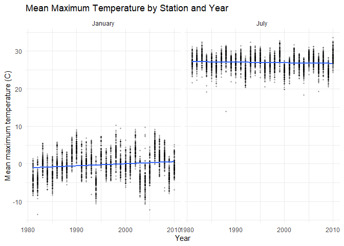
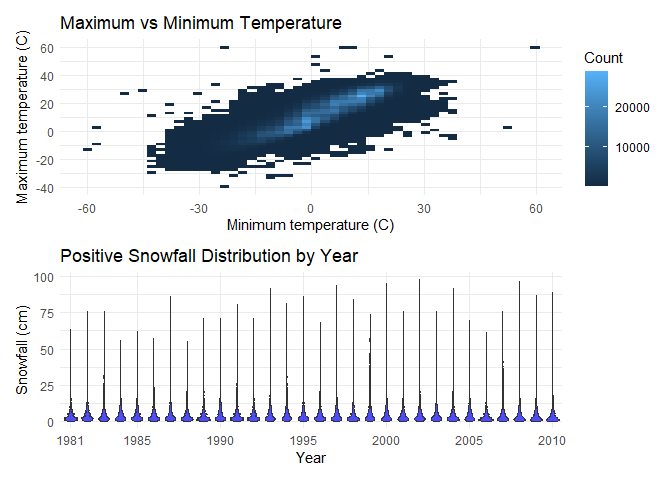

p8105_hw3_zc2959
================
Zhenghong Chen zc2959
2026-10-15

# Problem 1

``` r
library(p8105.datasets)
library(tidyverse)
library(patchwork)

data("ny_noaa")
```

## NY NOAA Data Description

1.  The `ny_noaa` dataset contains 2,595,176 daily observations from 747
    stations (1981–2010), with seven variables: `id`, `date`, `prcp`,
    `snow`, `snwd`, `tmax`, and `tmin`.

2.  Missing rates are highest for `tmax` and `tmin` (43.71% each),
    followed by `snwd` (22.80%), `snow` (14.69%), and `prcp` (5.62%).
    Station IDs and dates are complete.

## Data Cleaning

``` r
ny_noaa_clean =
  ny_noaa |>
  separate(
    date,
    into = c("year", "month", "day"),
    sep = "-"
  ) |>
  mutate(
    year = as.numeric(year),
    month = as.numeric(month),
    day = as.numeric(day),
    tmax = as.numeric(tmax) / 10,
    tmin = as.numeric(tmin) / 10,
    prcp = prcp / 10,
    snow = snow / 10,
    snwd = snwd / 10
  )
```

1.  The date was separated into numeric `year`, `month`, and `day`
    variables. Temperatures were converted to degrees Celsius,
    precipitation to millimeters, and snowfall and snow depth to
    centimeters.

2.  The most common value is 0 cm. Common positive values include 1.3,
    2.5, and 5.1 cm, consistent with measurements in approximate
    half-inch and whole-inch increments.

## Average Maximum Temperatures

``` r
monthly_tmax_df =
  ny_noaa_clean |>
  filter(month %in% c(1, 7)) |>
  drop_na(tmax) |>
  group_by(id, year, month) |>
  summarize(
    mean_tmax = mean(tmax),
    n_days = n()
  ) |>
  ungroup() |>
  mutate(
    month = case_when(
      month == 1 ~ "January",
      month == 7 ~ "July"
    )
  )
```

    ## `summarise()` has regrouped the output.
    ## ℹ Summaries were computed grouped by id, year, and month.
    ## ℹ Output is grouped by id and year.
    ## ℹ Use `summarise(.groups = "drop_last")` to silence this message.
    ## ℹ Use `summarise(.by = c(id, year, month))` for per-operation grouping
    ##   (`?dplyr::dplyr_by`) instead.

``` r
monthly_tmax_df |>
  ggplot(aes(x = year, y = mean_tmax)) +
  geom_point(alpha = .25, size = .7) +
  geom_smooth(method = "lm", se = FALSE) +
  facet_grid(. ~ month) +
  labs(
    title = "Mean Maximum Temperature by Station and Year",
    x = "Year",
    y = "Mean maximum temperature (C)"
  ) +
  theme_minimal()
```

    ## `geom_smooth()` using formula = 'y ~ x'

<!-- -->

1.  January is substantially colder than July. Mean maximum temperatures
    vary across stations and years.

2.  Some station-year averages are extreme, including approximately
    -13.4°C in January and 33.6°C in July. These values should be
    examined alongside the number of recorded days.

## Temperature and Snowfall Distributions

``` r
ggp_temp =
  ny_noaa_clean |>
  drop_na(tmax, tmin) |>
  ggplot(aes(x = tmin, y = tmax)) +
  geom_bin2d(bins = 50) +
  labs(
    title = "Maximum vs Minimum Temperature",
    x = "Minimum temperature (C)",
    y = "Maximum temperature (C)",
    fill = "Count"
  ) +
  theme_minimal()

ggp_snow =
  ny_noaa_clean |>
  filter(snow > 0, snow < 100) |>
  ggplot(aes(x = factor(year), y = snow)) +
  geom_violin(fill = "blue", alpha = .7) +
  scale_x_discrete(
    breaks = c("1981", "1985", "1990", "1995", "2000", "2005", "2010")
  ) +
  labs(
    title = "Positive Snowfall Distribution by Year",
    x = "Year",
    y = "Snowfall (cm)"
  ) +
  theme_minimal()

ggp_temp / ggp_snow
```

<!-- -->

1.  Maximum and minimum temperatures are strongly positively associated.
    However, 1,183 complete observations have `tmax < tmin`, suggesting
    possible data inconsistencies.

2.  Positive snowfall distributions are right-skewed across years, with
    most observations concentrated at smaller amounts.

# Problem 2

# Problem 3
